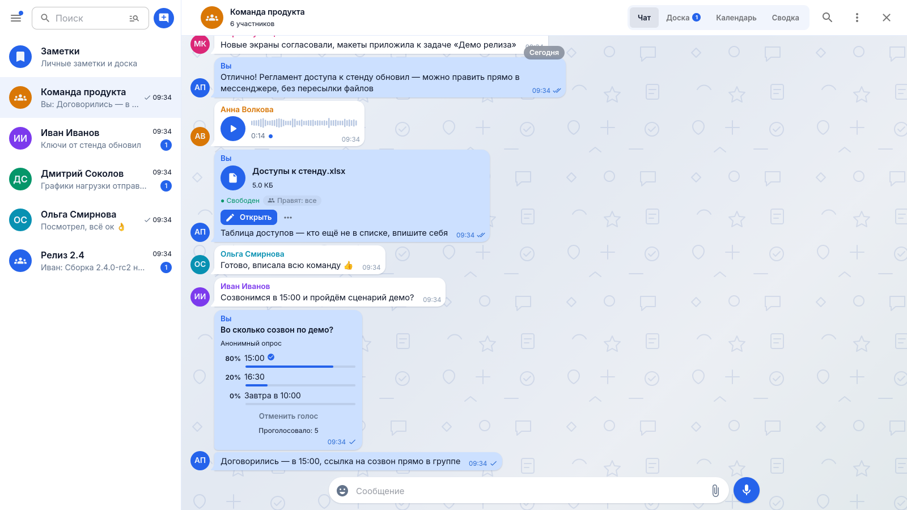
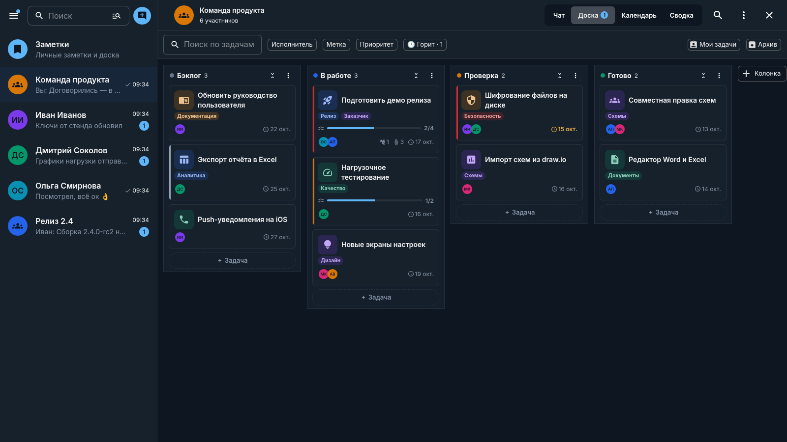

  

  
  
  
  
  

## 👨‍💻 Обо мне

- 🛠 Делаю full-stack: NestJS и .NET на сервере, React на вебе, Expo на телефоне
- 🚀 Основной проект — **Таск Мессенджер**: рабочий мессенджер, где у каждого чата своя канбан-доска
- 🏭 Параллельно делаю **СМИД**: мониторинг промышленных устройств в реальном времени
- 🧩 Люблю realtime: WebSocket, WebRTC-созвоны, совместное редактирование
- 🐳 Довожу до прода сам: Docker, nginx, миграции, push-уведомления

 

  

<table>
  <tr>
    <td width="50%"></td>
    <td width="50%"></td>
  </tr>
  <tr>
    <td align="center">💬 Переписка: голосовые, файлы с правкой в браузере, опросы</td>
    <td align="center">📋 Доска чата: метки, сроки, подзадачи, тёмная тема</td>
  </tr>
</table>

  

  

## 🧰 Стек

  

## 📂 Другие проекты

| Проект | О чём | Стек |
|---|---|---|
| [dashboard-next](https://github.com/mikkyfly/dashboard-next) | Новая версия дашборда | TypeScript |
| [OAuthNest](https://github.com/mikkyfly/OAuthNest) | OAuth-авторизация на NestJS | TypeScript |
| [system-monitoring-local](https://github.com/mikkyfly/system-monitoring-local) | Локальный мониторинг системы | TypeScript |
| [OrderTransport](https://github.com/mikkyfly/OrderTransport) | Заказ транспорта, бэкенд | C# |

  

